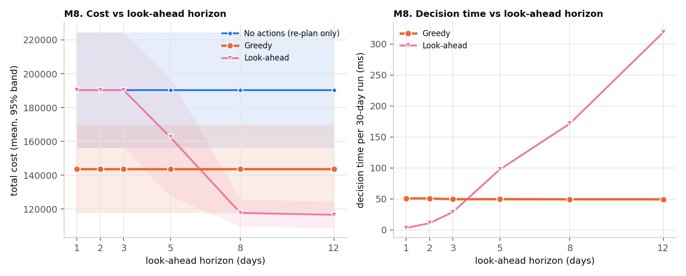
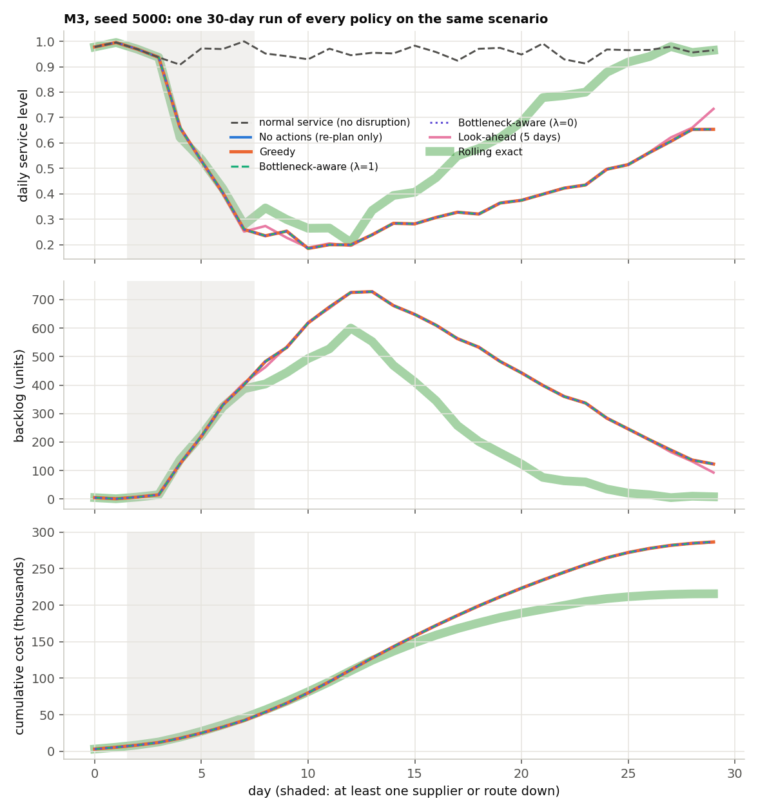
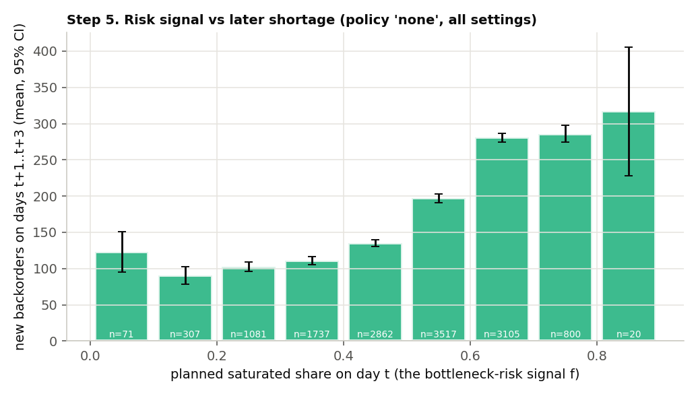

# SupplyChainX: Final Report

**Adaptive Supply Chain Recovery and Optimization Simulator.** CS3212 Design and Analysis of Algorithms project.

This report summarises what was built, how its correctness was established, and what the experiments measured. Every number in it comes from the C++ engine: from the test suites, or from the result files in `experiments/results/` (single-period experiments A to G) and `experiments/results/multiday/` (multi-day experiments M1 to M10). The detailed documents are listed in section 10.

## 1. Summary

A supply chain is modelled as a directed, capacitated, weighted graph of suppliers (some of them offline backups), warehouses, distribution centers and customers. The project implements, in C++17, the graph and flow algorithms needed to analyse a disruption and to plan a recovery. It adds a multi-day simulation in which goods take days to travel, stock and unserved orders carry over, and disruptions start and end on given days. A local JSON API and a React dashboard show only what the C++ engine computes.

Main findings:

1. **Recovery actions pay off.** Buying recovery actions (activating a backup supplier, reopening a route) and then shipping optimally clearly beats re-routing alone. Single period: about 21% lower mean cost. Over 30 days: the no-action policy was dearer than greedy in 21 of 25 settings.
2. **Greedy is good but measurably suboptimal.** Single period: about 2.2% above the exact optimum. Over 30 days, choosing each day's actions by exhaustive search was cheaper than greedy in 20 of 25 settings and never dearer.
3. **Look-ahead was the best tested multi-day policy, once its horizon was long enough.** With 8-12 days it was cheaper than both greedy and the per-day exhaustive search. Shorter than the action lead plus the supply lead, it never acted at all.
4. **The research hypothesis is not supported.** The bottleneck-aware heuristic, which penalises plans that rely on nearly saturated routes, showed no measurable improvement over greedy in either model (single period: +10 ± 17 over 200 runs; multi-day: no measurable difference in 29 of 29 settings). Its risk signal does predict later shortage, but almost nothing beyond what today's backlog already shows.

## 2. Problem and models

**Single-period model** (`MATHEMATICAL_MODEL.md`). Choose shipments and recovery actions that minimise purchase + transport + holding + shortage penalty + one-off action costs, subject to route capacities, supply and stock limits and flow conservation. For a fixed set of active suppliers and routes this reduces exactly to a minimum-cost flow. Choosing which actions to buy is the hard part: a restricted form is NP-complete in the weak sense (`NP_COMPLETENESS.md`).

**Multi-day model** (`MULTI_DAY_SIMULATION.md`). Days 0 to H−1, with H between 5 and 30.

* **Supply and transport:** supply and route capacities apply per day, and each route has a transit time in days.
* **Demand and backorders:** demand is a fixed daily sequence. Unserved demand is backordered at a daily cost, and anything still owed after the last day is charged the lost-sale penalty once.
* **Disruptions:** supplier and route failures are scheduled for given days and are restored later.
* **Recovery actions:** each one takes effect after a lead time.

Every simulated day follows the same 13-step order: arrivals, events, completed actions, capacities, demand, decision, plan, validation, dispatch, fulfilment, backlog, cost, record. The order is fixed so that no good is counted twice, nothing is used before it arrives, and no shortage is charged twice. A conservation check runs after every day:

`initial stock + initial pipeline + total drawn = stock + in transit + total served`

## 3. Algorithms implemented

| Algorithm | Purpose here | Time | Exact? |
|---|---|---|---|
| BFS, DFS | reachability and failure impact | O(V + E) | yes |
| Dijkstra (binary heap) | cheapest route; dispatch baseline; delivery delay of an action | O((V + E) log V) | yes, for non-negative costs |
| Edmonds-Karp, minimum cut | deliverable capacity and its bottleneck | O(V E²) | yes |
| Minimum-cost flow (successive shortest paths, potentials) | optimal shipments | O(V E + F (V + E) log V) | yes |
| Greedy and bottleneck-aware recovery | which actions to buy | O(k²) flow solves | no |
| Exhaustive recovery search | exact reference | 2^k flow solves | yes |
| Dynamic programming (inventory), backtracking (supplier selection), merge sort, topological sort | syllabus modules | see `COMPLEXITY_ANALYSIS.md` | yes |
| **Time-expanded min-cost flow, rolling horizon** | multi-day daily dispatch | one flow on about V·W nodes and (E + 2V)·W arcs per day | yes, for its window and information |
| **Multi-day policies:** greedy, bottleneck-aware (λ and λ = 0), look-ahead(h), rolling exact | which actions to buy each day | O(k²), O(k²), O(k² · h), 2^k plans per day | no (rolling exact is exhaustive for one day only) |
| **Clairvoyant lower bound** | evaluation | 2^k full-horizon plans | a valid lower bound |

**How the multi-day planner works.** Each node gets one copy per day of a planning window of W days. A route with transit L links `(i, τ)` to `(k, τ + L)`. Holding arcs carry stock to the next day, serving arcs reward meeting demand, and backward arcs at customers charge for late service. Stock on hand and known arrivals must enter the plan. One min-cost flow then gives the cheapest plan for the whole window; only today's shipments are executed, and the plan is redone tomorrow with new observations.

The window must be longer than the supply lead time (the time from a supplier to a customer), otherwise the planner never sees the benefit of anything it buys today. The simulator therefore enforces `W ≥ lead + supply lead + 1`.

**Information model (no leakage).** A policy never sees the scenario. It receives only a forecast:

* **Persistence:** today's network and demand are assumed to continue.
* **Perfect:** the true future inside the window.

Perfect-forecast results are reported separately, as an upper limit on what forecasting could give.

**Recovery time.** It is measured from the first disruption to the first day of 3 consecutive days at or above min(95%, normal service), after service first falls below that level. Normal service is the same scenario run without disruptions. The minimum is needed because demand noise sometimes pushes even a healthy network below 95%. A run that does not meet this definition inside the horizon is reported as "not recovered"; no number is invented for it.

## 4. Correctness

* **Test suite:** 15 C++ test executables run by CTest, with 143 cases and 8,149 assertions, all passing after a clean rebuild with no compiler warnings (`-Wall -Wextra -Wpedantic`). They include:
  * exhaustive-enumeration oracles for min-cost flow (25 random networks) and recovery (40 networks);
  * brute force for the inventory DP;
  * Floyd-Warshall for the topological sort.
* **Multi-day by hand:** a 5-day supply chain was calculated by hand day by day (served, backlog, goods in transit and cost of every day; total 715), and the simulator reproduces every value.
* **Multi-day invariants and bound:** the multi-day tests check the conservation invariant every day, arrivals exactly after their transit time and exactly once, capacities that reset every day, backorder accounting, the recovery-time definition, deterministic replay, and that no policy ever beats the clairvoyant lower bound.
* **Mutation checks:** deliberate defects were introduced, and each was caught by a test before being reverted. They include leaking future events through either of two paths, ignoring the warm-start pipeline, and dropping the planning-window rule.
* **Integration:** the API is tested through the service and over real sockets. A real-browser end-to-end test (38 checks) drives the dashboard against the real server. On the multi-day page it checks that the table shows exactly the totals in the captured server response.
* **Reproducibility:** re-running experiments M3, M8 and M9 with the rebuilt binary reproduced all 29,760 committed run and daily records in every non-timing column.

Details: `CORRECTNESS_AND_TESTING.md`.

## 5. Experimental method

**Paired design.** In each run one seeded scenario is built, and every strategy or policy runs on the identical inputs. Reported statistics:

* mean, sample standard deviation, and 95% Student-t intervals;
* paired differences with their 95% interval;
* counts of runs cheaper, dearer and equal.

A difference is called real only if its interval excludes 0.

**Single-period experiments A to G.** 27-node generated networks, 30 runs per setting (200 in G), covering random disruptions, supplier failures, route bottlenecks, demand spikes, network size, and an ablation of the risk term.

**Multi-day experiments M1 to M10.** 19-node networks over 30 days, 20 seeds per setting (40 in M9). Base case: transit 1-2 days, ±10% demand noise, and the two largest suppliers failing on day 2 for 6 days. Each experiment varies one factor:

| Experiment | Varies |
|---|---|
| M1 | number of failed suppliers |
| M2 | number of failed routes |
| M3 | multiple disruptions at once |
| M4 | spare capacity |
| M5 | transit time |
| M6 | demand noise |
| M7 | shortage penalty |
| M8 | look-ahead horizon |
| M9 | risk-term ablation |
| M10 | forecast mode (persistence vs perfect) |

Every run starts in steady state, with goods already in transit on every route; without that, a start-up shortage dominated all costs in trial runs.

## 6. Results

### 6.1 Single period (experiments A to G)

| Comparison | Measured |
|---|---|
| Recovery vs re-routing only (G, 200 runs) | −2,675 ± 350 mean cost (about 21% lower); fulfilment 84% → 96% |
| Greedy vs exact optimum (200 runs) | +222 ± 37 (about 2.2%) |
| Bottleneck-aware vs greedy (200 runs) | +10 ± 17; equal cost in 174 of 200 runs |
| Ablation, λ = 0.25 … 5 vs λ = 0 | every interval includes 0 |
| Runtime growth with network size | dispatch n^1.95, min-cost flow n^2.10, greedy n^3.05 |

### 6.2 Multi-day (experiments M1 to M10)

The table below shows each policy's paired cost difference to greedy over the same 20 scenarios. It is generated from the CSV files by `experiments/scripts/tables_multiday.py`.

Mean of cost(policy) − cost(greedy) over the same 20 scenarios, ± the 95% half-width, then (runs cheaper / dearer / equal). **Bold**: the 95% interval excludes 0 (negative = cheaper than greedy); otherwise the interval includes 0; = identical in every run.

| Exp | x | none − greedy | BA − greedy | BA λ=0 − greedy | look-ahead(5) − greedy | rolling exact − greedy |
|---|---|---|---|---|---|---|
| M1 | 1 | +7,284 ± 8,303 (0/8/12) | = (all equal) | = (all equal) | +3,653 ± 7,112 (1/5/14) | -9,135 ± 12,848 (13/1/6) |
| M1 | 2 | **+46,584 ± 25,452** (0/15/5) | = (all equal) | = (all equal) | +18,764 ± 23,719 (3/9/8) | **-23,945 ± 23,521** (19/0/1) |
| M1 | 3 | **+148,463 ± 39,324** (0/20/0) | +787 ± 1,617 (0/2/18) | = (all equal) | **+51,445 ± 24,781** (1/16/3) | **-12,715 ± 6,956** (15/1/4) |
| M2 | 1 | +335 ± 897 (1/1/18) | = (all equal) | = (all equal) | **-1,167 ± 410** (19/0/1) | **-2,544 ± 1,315** (20/0/0) |
| M2 | 2 | +11,419 ± 11,985 (1/7/12) | +9 ± 20 (0/1/19) | = (all equal) | **-1,512 ± 711** (19/1/0) | **-3,025 ± 1,327** (20/0/0) |
| M2 | 4 | **+55,037 ± 26,703** (2/14/4) | +209 ± 248 (0/3/17) | = (all equal) | **-2,726 ± 1,181** (19/1/0) | **-4,324 ± 1,464** (20/0/0) |
| M3 | 1 | **+94,705 ± 37,480** (2/18/0) | = (all equal) | = (all equal) | +31,637 ± 36,457 (10/10/0) | **-44,125 ± 34,086** (20/0/0) |
| M4 | 1.05 | **+76,885 ± 37,051** (0/15/5) | = (all equal) | = (all equal) | +23,849 ± 26,188 (5/8/7) | **-41,083 ± 39,871** (19/0/1) |
| M4 | 1.2 | **+46,584 ± 25,452** (0/15/5) | = (all equal) | = (all equal) | +18,764 ± 23,719 (3/9/8) | **-23,945 ± 23,521** (19/0/1) |
| M4 | 1.5 | **+8,345 ± 5,028** (1/13/6) | = (all equal) | = (all equal) | +3,976 ± 4,693 (4/8/8) | **-6,710 ± 4,973** (20/0/0) |
| M4 | 2 | +228 ± 273 (2/4/14) | = (all equal) | = (all equal) | -9 ± 345 (2/3/15) | **-2,338 ± 1,311** (13/3/4) |
| M5 | 0 | **+72,074 ± 29,584** (0/19/1) | +109 ± 180 (0/5/15) | = (all equal) | **-1,106 ± 626** (15/3/2) | **-1,258 ± 683** (16/3/1) |
| M5 | 1 | **+84,433 ± 32,019** (0/19/1) | +19 ± 64 (1/1/18) | = (all equal) | -112 ± 137 (5/0/15) | **-493 ± 337** (9/1/10) |
| M5 | 2 | **+89,683 ± 30,650** (0/20/0) | = (all equal) | = (all equal) | **+89,683 ± 30,650** (0/20/0) | -257 ± 376 (2/1/17) |
| M5 | 3 | **+80,787 ± 26,577** (0/20/0) | = (all equal) | = (all equal) | **+80,787 ± 26,577** (0/20/0) | -168 ± 261 (2/0/18) |
| M6 | 0 | **+48,300 ± 26,436** (0/14/6) | +90 ± 188 (0/1/19) | = (all equal) | +19,762 ± 24,512 (3/9/8) | **-24,478 ± 24,403** (20/0/0) |
| M6 | 0.2 | **+45,302 ± 24,055** (0/15/5) | = (all equal) | = (all equal) | +18,709 ± 21,964 (2/9/9) | **-23,161 ± 22,461** (19/0/1) |
| M6 | 0.4 | **+42,364 ± 21,195** (0/16/4) | = (all equal) | = (all equal) | +16,899 ± 18,730 (2/10/8) | **-21,524 ± 19,941** (18/0/2) |
| M6 | 0.6 | **+42,061 ± 19,737** (0/16/4) | = (all equal) | = (all equal) | **+18,505 ± 16,798** (1/11/8) | **-18,643 ± 17,304** (18/0/2) |
| M7 | 0.5 | **+20,001 ± 12,026** (0/13/7) | +2 ± 5 (0/1/19) | = (all equal) | +8,200 ± 11,313 (3/8/9) | **-16,986 ± 11,631** (19/0/1) |
| M7 | 1 | **+46,584 ± 25,452** (0/15/5) | = (all equal) | = (all equal) | +18,764 ± 23,719 (3/9/8) | **-23,945 ± 23,521** (19/0/1) |
| M7 | 2 | **+90,349 ± 51,439** (0/15/5) | = (all equal) | = (all equal) | +37,013 ± 48,182 (5/8/7) | -46,662 ± 47,798 (19/0/1) |
| M7 | 4 | **+176,310 ± 103,127** (0/15/5) | = (all equal) | = (all equal) | +74,662 ± 97,432 (5/8/7) | -90,518 ± 95,539 (19/0/1) |
| M10 | 0 | **+94,705 ± 37,480** (2/18/0) | = (all equal) | = (all equal) | +31,637 ± 36,457 (10/10/0) | **-44,125 ± 34,086** (20/0/0) |
| M10 | 1 | **+68,860 ± 33,438** (0/17/3) | = (all equal) | = (all equal) | +24,731 ± 29,869 (7/10/3) | **-34,520 ± 30,228** (20/0/0) |

**Where the policies differ.** The per-day exhaustive policy (rolling exact) gains most over greedy in three conditions:

* tight capacity: −41,083 at capacity factor 1.05;
* several disruptions at once: −44,125 in M3;
* high penalties.

The gains shrink with spare capacity. At factor 2.0 every policy is within 12-14% of the bound, and re-planning alone is within noise of greedy. Longer transit times raise every policy's distance from the bound: greedy is 3% above it at same-day transit and 31% at 3 days per route.

**Look-ahead and its runtime (M8).**

| Look-ahead horizon h | Look-ahead − greedy | Decision time per 30-day run |
|---|---|---|
| 1, 2, 3 days | +46,584 (never acts; same as no actions) | 3.2, 10.9, 28.9 ms |
| 5 days | +18,764 ± 23,719 (within noise) | 97.3 ms |
| 8 days | −25,987 ± 23,539 (19 of 20 runs cheaper) | 171.4 ms |
| 12 days | −27,074 ± 23,821 (20 of 20 cheaper) | 318.6 ms |

* **Growth:** decision time grows about as h^1.9. Greedy needs about 50 ms on the same scenarios.
* **Against rolling exact:** on the same scenarios, look-ahead(8) and look-ahead(12) were also cheaper than rolling exact, by −2,042 ± 1,711 and −3,129 ± 1,688.
* **Too short a horizon:** a look-ahead shorter than the action lead plus the supply lead is blind by construction. This is also why look-ahead(5) never acted when routes took 2-3 days each (M5).



**Value of information (M10).** With a perfect forecast every policy is cheaper on the multiple-disruption scenario:

* no actions: 331.4k → 233.6k;
* greedy: 236.7k → 164.7k;
* rolling exact: 192.5k → 130.2k, which is 6% above the clairvoyant bound, against 57% under persistence.

Under persistence, therefore, most of the distance to the bound is the value of knowing the future.

**Recovery time.** More failures, tighter capacity and longer transit times make recovery later and rarer. With multiple disruptions, at most 9 of 20 runs recovered within 30 days for any policy. In the base setting, rolling exact recovered in 20/20 runs after 11.7 days on average, against greedy's 18/20 runs after 14.3 days.



### 6.3 The research hypothesis: does accounting for bottleneck risk help?

* **Identical decisions at λ = 0.** Greedy and the bottleneck-aware score with λ = 0 made identical decisions in every multi-day run of every experiment.
* **Rare, small differences at λ > 0.** With λ > 0 the heuristic differed from greedy in only 1-5 of 20 runs per setting, in 7 of 25 settings. No difference reached 1% of the mean cost, and none had an interval excluding 0.
* **Ablation (M9, 40 seeds).** The differences were −723 to −1,340 against λ = 0, with intervals of about ±1,500 to ±1,800 that include 0.
* **Why it rarely matters.** The heuristic keeps adding every candidate that passes the shared eligibility test, so its score only changes the order of the purchases. Order changes the outcome only when one purchase makes another unnecessary, and with few candidates per day that is rare.
* **The risk signal itself (Step 5).** The signal is the share of planned flow on routes at 90% or more of capacity. It predicts the next 3 days' shortage (Spearman 0.41; mean future shortage 106.5 units in its lowest quartile against 287.2 in its highest). But today's backlog predicts the same shortage much better (Spearman 0.78), and adding the signal to a model with backlog and active disruptions raises R² only from 0.544 to 0.556.

**Verdict.** In neither model did the bottleneck-aware heuristic help or hurt measurably. Occasional individual runs where it is cheaper are not evidence for the hypothesis, and these experiments do not support it. This is a null result for the tested scenario families, not a proof that the idea can never help (see section 8).



## 7. Complexity in practice

The polynomial algorithms behave as their bounds predict on the generated networks; the growth exponents are in 6.1. The exponential parts are contained by explicit limits, and above a limit they are reported as skipped, never silently approximated:

* the single-period exact search;
* the multi-day rolling exact policy (2^k plans per day);
* the clairvoyant bound (2^k full-horizon plans);
* backtracking.

In the base multi-day scenario, decision time per 30-day run was about 50 ms for greedy, 72 ms for rolling exact and 97 ms for look-ahead(5). Details: `COMPLEXITY_ANALYSIS.md`.

## 8. Limitations

* **Model scope:** one product, no manufacturing, linear costs, fixed transit times, and no safety-stock policy in the planner.
* **Disruptions:** schedules are fixed per seed, and repeated or random disruptions were not tested.
* **Information:** "perfect" forecast is an upper limit, not a realistic forecast.
* **Policy limits:** rolling exact is exhaustive only over one day's choices, and the clairvoyant bound is valid but not always attainable by an online policy. Its gap therefore mixes heuristic loss with the value of information.
* **Narrow test conditions:** each part used one generator family on small networks, one machine for timing, and over 100 confidence intervals, so about 1 in 20 would exclude zero by chance.
* **Untested configurations:** the strongest case for the bottleneck-aware idea, a second disruption hitting a network that kept slack, was not part of these experiments.

Full list: `LIMITATIONS_AND_FUTURE_WORK.md`.

## 9. Reproducing the results

```powershell
cmake -S . -B build -G Ninja ; cmake --build build ; ctest --test-dir build
build\backend\scx_experiments.exe --out experiments\results                    # A-G, about 85 s
build\backend\scx_multiday_experiments.exe --out experiments\results\multiday  # M1-M10, about 16 min
python experiments\scripts\analyze_multiday.py ; python experiments\scripts\tables_multiday.py ; python experiments\scripts\plot_multiday.py
cd frontend ; npm test ; npm run build ; npm run e2e
```

## 10. Documents

| Document | Content |
|---|---|
| `PROBLEM_STATEMENT.md`, `MATHEMATICAL_MODEL.md` | the problem and the single-period model |
| `MULTI_DAY_SIMULATION.md` | the multi-day model, daily order, planner, policies, recovery time, and an explanation of each C++ component (data structures, state transitions, decisions, correctness conditions, complexity) |
| `ALGORITHMS.md`, `COMPLEXITY_ANALYSIS.md`, `NP_COMPLETENESS.md`, `DAA_SYLLABUS_MAPPING.md` | algorithms, bounds, hardness, syllabus coverage |
| `CORRECTNESS_AND_TESTING.md` | tests, oracles, mutation checks, the last verification run |
| `EXPERIMENTAL_EVALUATION.md` | full method and results of both experiment parts, with threats to validity |
| `SYSTEM_ARCHITECTURE.md`, `API_REFERENCE.md`, `USER_MANUAL.md`, `INSTALLATION_GUIDE.md`, `CPP_CONCEPTS_EXPLAINED.md` | software, API, usage, C++ explanations |
| `LIMITATIONS_AND_FUTURE_WORK.md`, `VIVA_PREPARATION.md` | limitations; questions and answers |
